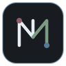

  
  <h1>neme</h1>
  
<strong>Инструменты для разработки, AI-агенты и модификации среды на Rust и JavaScript.</strong>

  

    
    
    
    
  

## О себе

Разрабатываю прикладные инструменты, терминальных клиентов и локальные расширения для рабочих сред. Делаю ставку на автономность, предсказуемое поведение, чистую архитектуру и отсутствие телеметрии.

## Проекты

- **[Project OxiCode](https://github.com/neme23232-rgb/Project-OxiCode)** — AI-агент для разработки на Rust (`edition = "2024"`) с единым ядром `oxicode-core`, поддержкой 10 API-провайдеров, MCP и откатом изменений; объединяет готовый терминальный клиент `oxicode-cli` и настольную версию `oxicode-ds` на Tauri v2 + WebView2.
- **[AGMod](https://github.com/neme23232-rgb/AGMod)** — локальная модификация для Google Antigravity на JavaScript: 14 тем оформления, студия цветов, загрузка системных шрифтов, полная локализация на 7 языков и менеджер профилей.

## Стек и направления

- **Языки** — Rust, JavaScript, HTML / CSS.
- **Платформы и инструменты** — Cargo, Tauri v2, WebView2, Node.js, Git.
- **Приоритеты** — автономные бинарники без лишних зависимостей, TUI/Desktop-интерфейсы, локальные патчи с резервным копированием.

## Контакты

- **GitHub** — [github.com/neme23232-rgb](https://github.com/neme23232-rgb)
- **Почта** — `neme23232-rgb@users.noreply.github.com`
