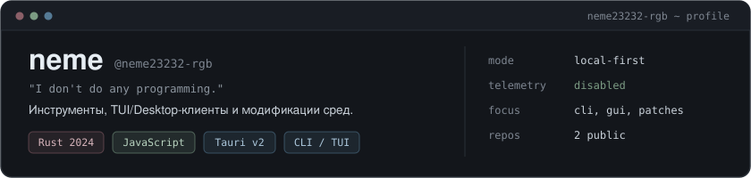

  <picture>
    <source media="(prefers-color-scheme: dark)" srcset="assets/header-dark.svg" />
    <source media="(prefers-color-scheme: light)" srcset="assets/header-light.svg" />
    
  </picture>
  

    
    
    
    
    
  

## Направления работы

- **Системные CLI и TUI-инструменты на Rust** — разработка автономных бинарников с общим ядром, поддержкой нескольких провайдеров API, MCP и безопасным откатом изменений.
- **Лёгкие настольные клиенты** — связка Rust-логики и интерфейса на базе Tauri v2 + WebView2 без громоздких обёрток.
- **Локальные модификации рабочих сред** — патчи, системы тем, редактор цветов, загрузка системных шрифтов и полная локализация интерфейса без передачи данных в сеть.

## Ключевые проекты

| Проект | Стек | Что внутри | Статус |
| --- | --- | --- | --- |
| **[Project OxiCode](https://github.com/neme23232-rgb/Project-OxiCode)** | `Rust 2024` · `Tauri v2` · `WebView2` | Рабочее пространство AI-инструментов на общем ядре `oxicode-core`: 10 API-провайдеров, откат `/undo` и `/redo`, MCP, готовый терминальный клиент `oxicode-cli` (15 тем, headless-режим) и десктопная версия `oxicode-ds`. | CLI `v0.1.0` / Desktop в разработке |
| **[AGMod](https://github.com/neme23232-rgb/AGMod)** | `JavaScript` · `Node.js` · `Batch` | Локальное расширение для Google Antigravity: 14 тем оформления, студия цветов с live-предпросмотром, выбор шрифтов Windows, перевод на 7 языков (1700+ фраз), слайдер глубины мышления и менеджер профилей. | Релиз `v2.24.0` (MIT) |

## Инструменты и принципы

- **Языки и рантаймы** — Rust (`edition = "2024"`), JavaScript, HTML / CSS, Node.js, PowerShell / Batch.
- **Сборка и среда** — Cargo, Tauri v2, WebView2, терминалы с поддержкой UTF-8 и TrueColor, Git.
- **Подход** — локальное выполнение, ноль телеметрии, обязательное резервное копирование перед патчами и минимальные внешние зависимости.

## Контакты

- **GitHub** — [github.com/neme23232-rgb](https://github.com/neme23232-rgb)
- **Почта** — [neme23232@gmail.com](mailto:neme23232@gmail.com)
