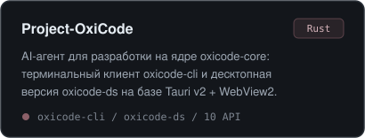
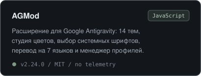

<div align="center">
  <picture>
    <source media="(prefers-color-scheme: dark)" srcset="assets/header-dark.svg" />
    <source media="(prefers-color-scheme: light)" srcset="assets/header-light.svg" />
    
  </picture>
</div>

<br />

```toml
[profile]
handle = "neme23232-rgb"
bio = "I don't do any programming."
approach = "local-first, zero telemetry, minimal dependencies"

[stack]
systems = ["Rust 2024", "Cargo", "TUI / CLI"]
desktop = ["Tauri v2", "WebView2", "JavaScript", "HTML / CSS"]
tooling = ["автономные бинарники", "резервные копии", "локальные патчи"]
```

<div align="center">
  <table>
    <tr>
      <td width="50%" align="center">
        <a href="https://github.com/neme23232-rgb/Project-OxiCode">
          <picture>
            <source media="(prefers-color-scheme: dark)" srcset="assets/card-oxicode-dark.svg" />
            <source media="(prefers-color-scheme: light)" srcset="assets/card-oxicode-light.svg" />
            
          </picture>
        </a>
      </td>
      <td width="50%" align="center">
        <a href="https://github.com/neme23232-rgb/AGMod">
          <picture>
            <source media="(prefers-color-scheme: dark)" srcset="assets/card-agmod-dark.svg" />
            <source media="(prefers-color-scheme: light)" srcset="assets/card-agmod-light.svg" />
            
          </picture>
        </a>
      </td>
    </tr>
  </table>
</div>

<br />

<div align="center">
  <sub>
    <a href="https://github.com/neme23232-rgb">github.com/neme23232-rgb</a>
    &nbsp;·&nbsp;
    <code>neme23232-rgb@users.noreply.github.com</code>
  </sub>
</div>
